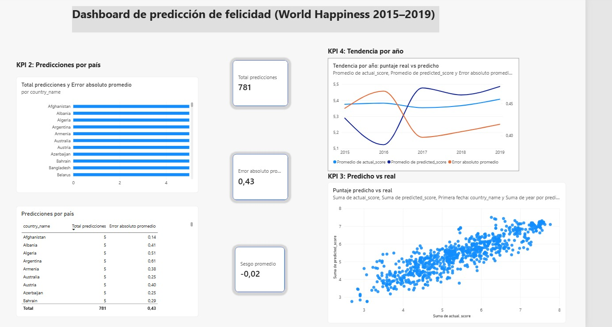

# Workshop 3: Streaming ETL con Kafka y predicción de felicidad

Curso ETL (G01) – Universidad Autónoma de Occidente

## 1. Descripción del proyecto

Este proyecto implementa un flujo de ETL en streaming que utiliza Apache Kafka y un modelo de regresión previamente entrenado para predecir el puntaje de felicidad de un país a partir de los datos del World Happiness Report (2015–2019).

El trabajo se divide en dos procesos:

- **Proceso offline (batch):** se exploran, limpian y unifican los cinco archivos CSV, se construyen las variables del modelo, se entrena un modelo de regresión y se guarda como `models/model.pkl`.
- **Proceso en streaming:** un *producer* publica eventos en Kafka, un *consumer* los valida, genera la predicción con el modelo guardado y almacena los resultados en PostgreSQL. Un dashboard en Power BI consulta esa base de datos.

Variable objetivo: `score` (puntaje de felicidad).
Variables predictoras: `gdp`, `family`, `health`, `freedom`, `generosity`, `corruption`.

## 2. Arquitectura

```
CSV unificado
     │
     ▼
 Producer ──► Kafka (topic: happiness-events) ──► Consumer
                                                     │
                                  ┌──────────────────┼──────────────────┐
                                  ▼                  ▼                  ▼
                          Guarda evento crudo   Valida contrato   Carga model.pkl
                       (raw_happiness_events)         │            y predice
                                                      └────────┬─────────┘
                                                               ▼
                                                  PostgreSQL (fact_predictions
                                                  + dim_country + dim_date)
                                                               │
                                                               ▼
                                                   Dashboard en Power BI
```

| Componente | Tecnología |
|---|---|
| Mensajería | Apache Kafka (contenedor Docker, modo KRaft) |
| Modelo | scikit-learn (`StandardScaler` + `LinearRegression`) |
| Base de datos | PostgreSQL 16 (contenedor Docker) |
| Dashboard | Power BI Desktop |
| Lenguaje | Python |

### Estructura del repositorio

```
project/
├── data/
│   ├── raw/                    # CSV originales 2015–2019
│   └── processed/              # happiness_unified.csv
├── etl/transform.py            # armonización y limpieza
├── notebooks/
│   ├── eda.ipynb
│   └── model_training.ipynb
├── models/model.pkl
├── kafka/
│   ├── producer.py
│   └── consumer.py
├── sql/
│   ├── create_tables.sql
│   └── kpis.sql
├── dashboards/                 # .pbix y capturas
├── docker-compose.yml
├── requirements.txt
└── README.md
```
## 3. Decisiones de limpieza de datos

Los cinco archivos (2015–2019) se armonizan y limpian en `etl/transform.py`, que genera `data/processed/happiness_unified.csv`.

**Problemas encontrados y decisiones**

| Problema | Decisión |
|---|---|
| Los nombres de columna cambian entre años (por ejemplo `Economy (GDP per Capita)`, `Economy..GDP.per.Capita.` y `GDP per capita`). | Se renombran todas a un esquema común: `country`, `year`, `score`, `gdp`, `family`, `health`, `freedom`, `generosity`, `corruption`. |
| Los archivos traen columnas que no existen en todos los años (región, ranking, error estándar, intervalos de confianza, *dystopia residual*). | Se descartan y se conservan solo las columnas comunes a los cinco años. |
| Los archivos no tienen columna de año. | Se agrega `year` a partir del archivo de origen. |
| El mismo país aparece con nombres distintos según el año. | Se unifican nombres, por ejemplo: `Hong Kong S.A.R., China` → `Hong Kong`, `Taiwan Province of China` → `Taiwan`, `Trinidad & Tobago` → `Trinidad and Tobago`, `North Cyprus` → `Northern Cyprus`, `Macedonia` → `North Macedonia`, `Somaliland Region` → `Somaliland region`. |
| Espacios sobrantes en los nombres de país. | Se aplica `strip()`. |
| Un valor nulo en `corruption` (2018). | Se elimina esa fila con `dropna()`. |
| Valores en cero en las variables numéricas (5 por variable, 6 en corrupción). | Se conservan: son valores posibles en el reporte y no se consideran errores de captura. |
| Duplicados exactos. | No se encontraron. |

**Resultado:** de 782 filas originales (158 + 157 + 155 + 156 + 156) se pasa a **781 filas** y **164 países**. 145 países aparecen en los cinco años y los demás en menos años.

## 4. Decisiones de ingeniería de variables

**Variable objetivo:** `score`.

**Variables predictoras (6):** `gdp`, `family`, `health`, `freedom`, `generosity`, `corruption`.

**Variables excluidas**
- `country` y `year`: son identificadores, no variables explicativas.
- Ranking, error estándar, intervalos de confianza y *whiskers*: no existen en todos los años o se derivan del propio puntaje.
- *Dystopia residual*: no está disponible en 2018 y 2019.

**Preprocesamiento y modelo**
- `StandardScaler` y `LinearRegression` se encadenan en un `Pipeline` de scikit-learn. Así el mismo escalado aprendido en el entrenamiento se aplica en el consumer, sin repetir código.
- División 70 % entrenamiento y 30 % prueba, con `random_state=42`.
- Métricas sobre el conjunto de prueba: MAE = 0,418; RMSE = [completar]; R² = [completar].
- Modelo serializado con `joblib` en `models/model.pkl`.
- El orden de las variables debe ser siempre `gdp, family, health, freedom, generosity, corruption`.
- Para cargar el modelo se necesita la misma versión de scikit-learn con la que se entrenó (1.9.1).
- No se creó ninguna variable nueva: se usaron las seis originales del reporte.
## 5. Pipeline de Kafka y contrato de eventos

**Configuración**
- Topic: `happiness-events` (3 particiones, factor de replicación 1).
- Clave del mensaje: `country`. Los eventos del mismo país van a la misma partición, y Kafka solo garantiza orden dentro de una partición.
- Grupo de consumidores: `happiness-ml-team`, con `auto.offset.reset=earliest` y confirmación manual del offset (se confirma después de procesar cada mensaje).

**Producer (`kafka/producer.py`):** lee `data/processed/happiness_unified.csv`, convierte cada fila en un evento JSON y lo publica. Cuenta los mensajes entregados y fallidos mediante el *callback* de entrega. Opciones: `--delay`, `--limit`, `--dry-run`.

**Consumer (`kafka/consumer.py`):** por cada mensaje realiza estos pasos:
1. Guarda el mensaje tal como llegó en `raw_happiness_events` (estado `RECEIVED`), antes de validarlo.
2. Valida el contrato del evento.
3. Carga `models/model.pkl` y genera la predicción con las seis variables en el orden correcto.
4. Guarda la predicción en `fact_predictions` y marca el evento crudo como `VALID`.

**Contrato del evento**

| Campo | Tipo | Descripción |
|---|---|---|
| `event_id` | texto | Identificador del evento (por ejemplo `E0001`) |
| `country` | texto | País |
| `year` | entero | Año del dato histórico |
| `gdp`, `family`, `health`, `freedom`, `generosity`, `corruption` | número | Variables del modelo |
| `actual_happiness_score` | número | Puntaje real. Se usa solo para calcular el error, **nunca** como variable de entrada |
| `event_time` | texto | Fecha y hora del evento en formato ISO-8601 |

**Reglas de validación y estados**

| Estado | Cuándo ocurre |
|---|---|
| `RECEIVED` | El mensaje se guardó pero aún no se procesa |
| `VALID` | Cumple el contrato y se generó la predicción |
| `INVALID_SCHEMA` | JSON inválido, campo faltante, vacío o de tipo incorrecto |
| `INVALID_VALUES` | `year` fuera de 1900–2100, variables negativas o no finitas, puntaje fuera de 0–10 o `event_time` no válido |
| `PREDICTION_ERROR` | Falló la carga del modelo o la predicción |

Resultado de la ejecución completa: **781 eventos, todos `VALID`**.

## 6. Esquema de la base de datos (PostgreSQL)

El script `sql/create_tables.sql` crea cuatro tablas (se puede ejecutar varias veces sin error):

| Tabla | Descripción |
|---|---|
| `raw_happiness_events` | Mensaje crudo de Kafka (tópico, partición, offset, clave, `raw_payload`), estado de procesamiento y mensaje de error. Es única por tópico, partición y offset. |
| `dim_country` | Dimensión país (`country_id`, `country_name`). |
| `dim_date` | Dimensión fecha, construida desde `event_time` (`date_id` con formato AAAAMMDD, fecha, año, mes y día). |
| `fact_predictions` | Una fila por predicción: país, fecha, `year`, `actual_score`, `predicted_score`, `prediction_error`, `event_time` y `prediction_timestamp`. Se enlaza con un único evento crudo. |

`prediction_error = predicted_score − actual_score` (con signo): positivo significa que el modelo sobreestimó.

```
dim_country ──┐
              ├──► fact_predictions ◄── raw_happiness_events
dim_date ─────┘
```

`sql/kpis.sql` crea la vista `vw_predictions_detail`, que une el hecho con sus dimensiones y es la fuente del dashboard.

)

## 7. Dashboard

Archivo: `dashboards/happiness_dashboard.pbix` (Power BI Desktop). El dashboard **consulta PostgreSQL directamente** (base `happiness_db`, vista `vw_predictions_detail`), no archivos CSV.



| KPI | Visual | Qué muestra e interpretación |
|---|---|---|
| 1. Error promedio de predicción | Tarjetas | Total de predicciones (**781**), error absoluto promedio (**0,427** puntos en una escala de 0 a 10) y sesgo promedio (**−0,016**). Un sesgo cercano a cero indica que el modelo no tiende a sobreestimar ni a subestimar. |
| 2. Predicciones por país | Tabla y Top 10 | Cantidad de predicciones y error medio por país. La mayoría tiene 5 (una por año). El Top 10 muestra dónde falla más el modelo, por ejemplo Botswana (1,468) y Costa Rica (1,062). |
| 3. Predicho vs real | Gráfico de dispersión | Cada punto es una predicción. Cuanto más cerca de la diagonal, más acertada. La correlación entre el puntaje real y el predicho es **0,873**. |
| 4. Tendencia en el tiempo | Gráfico de líneas | Promedio anual del puntaje real, del predicho y del error absoluto. El puntaje real es estable (≈ 5,35–5,41). El modelo subestima en 2015–2016 y sobreestima desde 2017. El error es mayor en 2016 (0,469) y menor en 2017 (0,397). |

Las consultas equivalentes en SQL están en `sql/kpis.sql`.

## 8. Instrucciones de ejecución

**Requisitos:** Windows con Docker Desktop encendido, Python 3 (comando `py`) y Power BI Desktop.

**1. Instalar dependencias**
```powershell
py -m pip install -r requirements.txt
```
**1b. Configurar credenciales**
```powershell
Copy-Item .env.example .env
```
Edite `.env` y cambie las contraseñas. El archivo `.env` no se sube al repositorio.

**2. Levantar Kafka y PostgreSQL**
```powershell
docker compose up -d
```
PostgreSQL queda en `localhost:5432` (base `happiness_db`, usuario `happiness_user`, contraseña `happiness_pass`; solo para uso local).
**2b. Crear el tópico de Kafka** (3 particiones; no falla si ya existe)
```powershell
docker exec happiness-streaming-broker /opt/kafka/bin/kafka-topics.sh --bootstrap-server localhost:9092 --create --if-not-exists --topic happiness-events --partitions 3 --replication-factor 1
```

**3. Crear las tablas**
```powershell
Get-Content sql\create_tables.sql | docker compose exec -T postgres psql -U happiness_user -d happiness_db
```

**4. Preparar los datos y el modelo** (proceso offline)
```powershell
py etl/transform.py
```
Luego ejecute `notebooks/model_training.ipynb` completo para generar `models/model.pkl`. El notebook `notebooks/eda.ipynb` contiene el análisis exploratorio.

**5. Ejecutar el consumer** (primera ventana de PowerShell)
```powershell
py kafka/consumer.py
```

**6. Ejecutar el producer** (segunda ventana de PowerShell)
```powershell
py kafka/producer.py
```
Opciones útiles: `--delay 0.5` (segundos entre mensajes), `--limit 20` (solo 20 eventos) y `--dry-run` (sin enviar).

**7. Verificar la carga**
```powershell
docker compose exec -T postgres psql -U happiness_user -d happiness_db -c "SELECT processing_status, COUNT(*) FROM raw_happiness_events GROUP BY 1;"
```
Debe mostrar 781 eventos `VALID`.

**8. Crear la vista de los KPIs**
```powershell
Get-Content sql\kpis.sql | docker compose exec -T postgres psql -U happiness_user -d happiness_db
```

**9. Abrir el dashboard**
Abra `dashboards/happiness_dashboard.pbix` en Power BI Desktop. Si pide conexión: servidor `localhost:5432`, base `happiness_db`, usuario y contraseña indicados arriba. Use **Actualizar** para recargar los datos.
